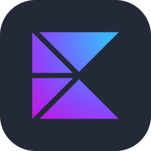
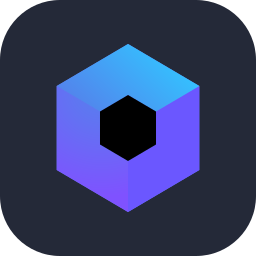
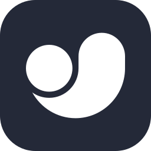
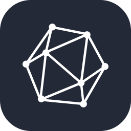
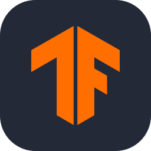
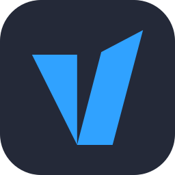
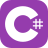
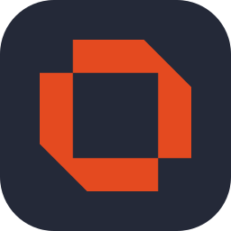

# Hey, I'm Daksh 👋

### Software Engineer · Polyglot builder

Since 2016 I've shipped software wherever the problem lives. Right now that means computer vision, model fine-tuning, and agentic harnesses and skills, on top of native and multiplatform apps, backend services and homelab infrastructure. I pick the stack for the job, not the one I like best.

Open source your work. Knowledge is free.

---

### 🚀 Featured Projects

| Project | What it does | Stack |
|---|---|---|
| [**Nyx**](https://github.com/daksh7011/Nyx) | Hides a password-locked message inside an ordinary image with AES-256-GCM and LSB steganography. Runs on Android, iOS, desktop and web from one codebase. | Kotlin · Compose Multiplatform |
| [**immich-backup**](https://github.com/daksh7011/immich-backup) | Backs up self-hosted Immich: syncs media with rclone, dumps the database with `pg_dumpall` and runs on a schedule as a user service. A TUI wizard handles setup. | Go · Homebrew |
| [**advisor-mode**](https://github.com/daksh7011/advisor-mode) | Turns AI coding agents into blunt advisors that challenge your assumptions, rate their own confidence and hold their position under pushback. | Claude Code plugin · Codex |
| [**Links Detektor**](https://github.com/daksh7011/Links-Detektor) | Finds and extracts URLs from plain text, JSON, XML and HTML, including odd IP formats. Ships on Maven Central. | Kotlin |
| [**Troy**](https://github.com/daksh7011/troy) | Powers community Discord servers with a feature-rich bot. | Kotlin · Kord · Docker |

---

### 🛠 Toolbox

**Mobile & Multiplatform**

<table>
  <tr>
    <td align="center" width="96"> Kotlin</td>
    <td align="center" width="96"> KMP</td>
    <td align="center" width="96"> Compose MP</td>
    <td align="center" width="96"> Java</td>
  </tr>
  <tr>
    <td align="center" width="96"> Swift</td>
    <td align="center" width="96"> Android Studio</td>
    <td align="center" width="96"> Gradle</td>
  </tr>
</table>

**AI & Computer Vision**

<table>
  <tr>
    <td align="center" width="96"> PyTorch</td>
    <td align="center" width="96"> OpenCV</td>
    <td align="center" width="96"> Hugging Face</td>
    <td align="center" width="96"> YOLO</td>
    <td align="center" width="96"> ONNX</td>
  </tr>
  <tr>
    <td align="center" width="96"> TFLite</td>
    <td align="center" width="96"> Unsloth</td>
    <td align="center" width="96"> vLLM</td>
    <td align="center" width="96"> Claude Code</td>
  </tr>
</table>

**Backend**

<table>
  <tr>
    <td align="center" width="96"> Python</td>
    <td align="center" width="96"> Go</td>
    <td align="center" width="96"> TypeScript</td>
    <td align="center" width="96"> Node.js</td>
  </tr>
  <tr>
    <td align="center" width="96"> C#</td>
    <td align="center" width="96"> Ktor</td>
    <td align="center" width="96"> Spring</td>
  </tr>
</table>

**Infra & DevOps**

<table>
  <tr>
    <td align="center" width="96"> Docker</td>
    <td align="center" width="96"> Kubernetes</td>
    <td align="center" width="96"> Ansible</td>
    <td align="center" width="96"> Linux</td>
    <td align="center" width="96"> Bash</td>
  </tr>
  <tr>
    <td align="center" width="96"> GitHub Actions</td>
    <td align="center" width="96"> GitLab CI</td>
    <td align="center" width="96"> Jenkins</td>
    <td align="center" width="96"> Proxmox</td>
    <td align="center" width="96"> OPNsense</td>
  </tr>
</table>

---

### ✍️ Recent Blog Posts

<!-- BLOG-START -->
- [You Can't Force Sleep. You Can't Force Speed Either.](https://slothiesmooth.dev/you-cant-force-sleep-you-cant-force-speed-either/)
- [I Built Varve. Most of It Was Finding Out I Was Wrong.](https://slothiesmooth.dev/i-built-varve-most-of-it-was-finding-out-i-was-wrong/)
- [I Set Up QoS on OPNsense in Ten Minutes. Proving It Worked Took 4 A.M](https://slothiesmooth.dev/i-set-up-qos-on-opnsense-in-ten-minutes-proving-it-worked-took-4-a-m/)
- [Project Warden - Distributed AI Infrastructure on Consumer Hardware](https://slothiesmooth.dev/project-warden-distributed-ai-infrastructure-on-consumer-hardware/)
- [Enterprise-Grade Network Security: Virtualized OPNsense on Proxmox](https://slothiesmooth.dev/enterprise-grade-network-security-virtualized-opnsense-on-proxmox/)
<!-- BLOG-END -->

> 📝 Read more at [slothiesmooth.dev](https://slothiesmooth.dev)

---

### 🤝 Connect

